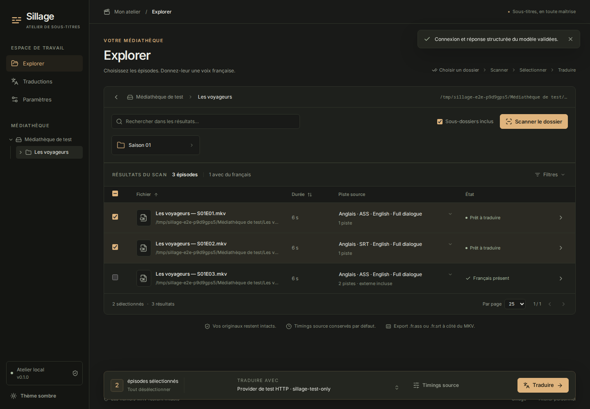

<p align="center"></p>
<h1 align="center">Sillage</h1>
<p align="center"><strong>A focused, self-hosted subtitle translation studio.</strong><br>Browse a folder, choose your MKV tracks, translate and export safe sidecars.</p>
<p align="center">
  <a href="https://github.com/lucas-lepajollec/sillage/actions/workflows/ci.yml"></a>
  <a href="https://github.com/lucas-lepajollec/sillage/pkgs/container/sillage"></a>
  <a href="LICENSE"></a>
</p>

## 1. Overview

Sillage translates text subtitles already present in your MKVs, especially English anime subtitles you want to read in French. It also accepts matching external ASS/SSA/SRT files. The interface is in French, with dark and light themes.

**Choose a folder → scan → select episodes and tracks → translate → use the sidecars.**

Original MKVs and source subtitles stay intact. Translation preserves source timestamps. Unsupported karaoke, drawings or animations remain untouched and produce explicit review warnings. Sillage stays focused on this workflow; it does not index your entire library at startup or manage your media servers.

## 2. Product preview



The screenshot uses generated test media, not a private library. [Before/after preview](docs/screenshots/translation-preview-dark.png) · [Light theme](docs/screenshots/translations-light.png) · [Mobile preview](docs/screenshots/preview-mobile.png).

## 3. Highlights

- Lazy folder navigation, breadcrumbs, recursive scans, filters and explicit per-episode source tracks; apply equivalent tracks to selected episodes, one folder or the whole scan with a checked match list.
- Embedded and external ASS/SSA/SRT; PGS/VobSub detected and clearly excluded from translation.
- Reasoning disabled when supported; required reasoning stays usable with explicit time/token warnings.
- Paginated translation history with search/status filters and readable mobile form fields.
- Folder-based translation history, free source reanalysis and confirmed cleanup of inactive entries/checkpoints while preserving media and exported subtitles.
- Guided setup for OpenAI, Anthropic, Gemini, DeepSeek, OpenRouter, Groq, Mistral, xAI, Ollama, LM Studio, vLLM, llama.cpp and compatible endpoints: live model discovery/search, manual fallback, multiple profiles and optional glossaries.
- Strict cue IDs and protected formatting, neighboring context, bounded requests/retries and encrypted backend provider keys.
- Adaptive batches start conservatively, retry only invalid cues, reduce temporarily and grow again after successful waves without slowing every later episode.
- Per-letter ASS typography stays unchanged with review warnings; non-rendered editor comments cannot block an export merely by ending after the video.
- SQLite checkpoints, real processing stages, cancellation and resume without retranslating validated batches.
- Atomic external exports such as `Episode 01.fr.ass`, without replacing existing output.
- Explicit manual offsets and conservative audio-only synchronization proposals requiring your acceptance.
- One container: compiled React frontend, FastAPI, SQLite, worker, FFmpeg/MKVToolNix and ffsubsync. No Node server in production.

## 4. Quick start

Install Docker with Compose. Save the following as `docker-compose.yml` in a new directory:

```yaml
services:
  sillage:
    image: ghcr.io/lucas-lepajollec/sillage:latest
    ports:
      - "2511:2511"
    environment:
      PUID: ${PUID:-1000}
      PGID: ${PGID:-1000}
    volumes:
      - ./config:/config
      - ${MEDIA_PATH:-./media}:/media:rw
    security_opt:
      - no-new-privileges:true
    restart: unless-stopped
```

Point `MEDIA_PATH` to your actual host library in an optional `.env`, and set `PUID`/`PGID` to its owner/group (`id -u`, `id -g`). Without that file, Sillage starts with an empty `./media` folder and persists settings in `./config`.

```bash
docker compose up -d
```

Open **`http://<your-server-ip>:2511`**. In **Paramètres**, choose a provider, enter its key or local server URL and select a model. Catalogue lookup does not generate text; the separate connection test makes a real model request and may incur the provider's normal charge. Then browse `/media` in **Explorer**.

You can also clone this repository and use its identical [Compose file](docker-compose.yml):

```bash
git clone https://github.com/lucas-lepajollec/sillage.git
cd sillage
# Optional: copy .env.example to .env and set your host media path and UID/GID.
docker compose up -d
```

This downloads the published image; it does not build source or require Python/Node on your NAS. For a reproducible release, replace `:latest` with `:0.0.8` or a recorded image digest. [Detailed Docker operations](docs/docker.md).

Updating from 0.2.0 or earlier? Change the Compose port mapping to `2511:2511` before pulling the new image. See [port migration and rollback](docs/docker.md#updating-from-020-or-earlier).

## 5. Configuration and persistence

| Setting or mount | Purpose |
| --- | --- |
| `./config:/config` | SQLite jobs, checkpoints, provider settings and separate encryption key. Back up the entire directory together. |
| `${MEDIA_PATH:-./media}:/media:rw` | Host library. Read access for MKVs/source tracks, write access for translated sidecars. |
| `PUID` / `PGID` | Worker identity, default `1000:1000`. The root entrypoint initializes config ownership, then drops privileges. Media ownership is never changed. |
| Port `2511:2511` | Same published and container port. Adapt the host side if it is already used. |
| `MEDIA_ROOTS` | Advanced backend roots, default `/media`; colon-separated paths inside the container. Mount each directory explicitly. |
| `ACCESS_KEY` | Optional shared access key, configured through a private Compose override. |
| `ALLOWED_HOSTS` | Additional hostname allowlist for a local reverse proxy; private IPs and localhost work by default. |

Providers, model IDs, source/target languages, glossary, batch size, concurrency, timeouts and retries are configured in the UI. One episode runs at a time, with one provider request at a time by default. See [provider setup](docs/providers.md). Existing jobs keep an encrypted snapshot of their model/languages; operational limit edits apply to the next wave without invalidating checkpoints. Use **Traductions → Paramètres** (one job) or **Adapter les paramètres** (current group) to explicitly switch settings and resume in place, keeping validated cues or restarting after confirmation.

A full French track can be filtered out; forced/signs-only French metadata does not automatically count as a complete translation. Review unknown or incorrect language tags manually.

### Choose and verify the source track

After scanning, use **Piste source** or **Vérifier la piste** for each episode. The preview identifies the selected title, language, format, stream and default/forced/SDH indicators. It shows how many events are eligible for AI translation and how many stay unchanged. Previewing extracts/reads subtitles without contacting a provider. An ASS event is not necessarily a unique sentence; repeated eligible events are counted separately.

Use **Choisir les pistes** to apply equivalent tracks to selected episodes, an exact folder (excluding its subfolders) or all scanned episodes. The review list shows the exact scope, matches and skipped files before applying. Equivalence uses language, normalized title, format, embedded/external kind and forced/SDH indicators, never the stream number. External filenames vary by episode and are not compared. Missing or ambiguous matches keep their current choice. Search and filters do not narrow the explicitly chosen scope. You can return to the automatic choice for the same scope or for one episode. Choices last until a new scan.

New jobs record their source-track metadata and show it in the translation list and preview. Older jobs retain their original track ID; their preview can read its current MKV label, explicitly marked as current metadata rather than a historical snapshot. **Reprendre** uses the original track and checkpoints. To change tracks, create a new translation from the explorer. Applying choices does not modify existing jobs.

### Browse and manage translation history

**Traductions** opens in **Dossiers** view, grouped by the exact source folder. Cards show the parent/folder name, full path, entry count, active jobs and errors. Open a folder to see its paginated jobs; **Tous les dossiers** returns to the overview. Search and status filters apply before grouping. A **Liste** alternative is remembered locally, and both folders and jobs use the 5/10/25 pagination controls. Queue totals remain global.

**Réanalyser** rereads one job's MKV without a provider call, then prepares that episode in the explorer and opens its source preview. The previous track is selected when still available; otherwise Sillage warns and proposes its usual automatic choice. The old job/checkpoints stay intact. Only pressing **Traduire** queues a new generation. An existing subtitle export is never overwritten; inspect/manage that file separately if replacing a finished result.

**Supprimer** removes one inactive history entry, its checkpoints and temporary work files after confirmation. **Nettoyer l’historique** selects inactive entries in the current folder/search/filter across all pages (up to 500 per confirmation). Cancel active jobs first; deletion is refused while a cancellation is still running and is serialized with synchronization decisions. MKVs, source subtitles, provider profiles and exported sidecars remain on disk. If permissions prevent work-file cleanup, the UI reports the leftover files instead of claiming complete cleanup. **Reprendre les erreurs** follows the same folder/search/filter scope across pages.

## 6. Security, privacy, and limitations

Use a trusted LAN or VPN. The default Compose publishes on host interfaces, without application authentication until you configure an access key. For wider exposure, use an access key, HTTPS/reverse proxy and appropriate firewall rules. A [localhost-only override and access-key setup](docs/docker.md#network-access) are documented.

Cloud translation sends subtitle text, context and glossary to your chosen provider. Keys stay on the backend and are encrypted at rest; an administrator with both the database and its key can still decrypt them. Never publish config, logs containing private text or real credentials.

**Preserved timestamps do not mean verified audio synchronization.** Automatic alignment uses the first audio track, proposes only a bounded global offset and can refuse uncertain material. It requires 2 minutes–4 hours of audio and at least 20 usable cues. It does not fix clock drift or different cuts.

ASS syntax preservation does not prove that longer French signs fit their original position or that your player has the expected fonts. Complex karaoke, drawings, transformations and effects can remain untranslated with warnings. Real-model language quality, actual Jellyfin playback and sync confidence on your collection still require operator acceptance. [Detailed limits](docs/limits.md) · [Security policy](SECURITY.md).

## 7. Architecture

```text
Browser — React / TypeScript / TanStack
              │ HTTP / progress polling
FastAPI — compiled frontend + confined media API
              │
SQLite checkpoints ─ single worker ─ configured cloud/LAN provider
              │
FFmpeg inspection/extraction ─ guarded subtitle reconstruction
              │
Validated external sidecar beside the original MKV
```

pysubs2 independently validates structure/timings while Sillage patches original text spans. A bounded lexer adapted from Sublarr protects ASS drawing state. ffsubsync's FFT engine and WebRTC VAD supply conservative audio proposals. [Reuse/source audit](docs/research.md) · [Third-party notices](THIRD_PARTY_NOTICES.md).

## 8. Development and quality

Prerequisites: Python 3.12+, uv, Node 22+, FFmpeg/ffprobe and Docker.

```bash
uv sync --frozen --extra dev --extra sync --python 3.12
npm --prefix frontend ci
uv run ruff check backend tests scripts
uv run --extra dev --extra sync pytest -q
npm --prefix frontend run check
npm --prefix frontend run build
```

The [contribution guide](CONTRIBUTING.md) covers local development, browser tests and container smoke tests. [Verification status](docs/STATUS.md) distinguishes executed tests from real-library acceptance.

To build the current checkout rather than pull an image:

```bash
docker compose -f docker-compose.yml -f docker-compose.build.yml up -d --build
```

## 9. Public demo

There is no hosted public demo. Screenshots and browser tests use disposable generated media; the production app has no mock translation provider.

## 10. Documentation and community

- [Docker installation, updates, backups and rollback](docs/docker.md)
- [Providers](docs/providers.md), [ASS/sync limits](docs/limits.md), [verification](docs/STATUS.md)
- [Contributing](CONTRIBUTING.md), [support](SUPPORT.md), [code of conduct](CODE_OF_CONDUCT.md)
- [Issues](https://github.com/lucas-lepajollec/sillage/issues), [private security reports](SECURITY.md), [changelog](CHANGELOG.md)
- [GPL-3.0-only license](LICENSE), [third-party notices](THIRD_PARTY_NOTICES.md)
